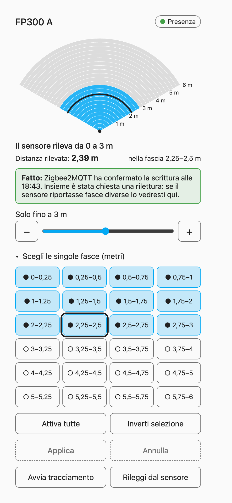
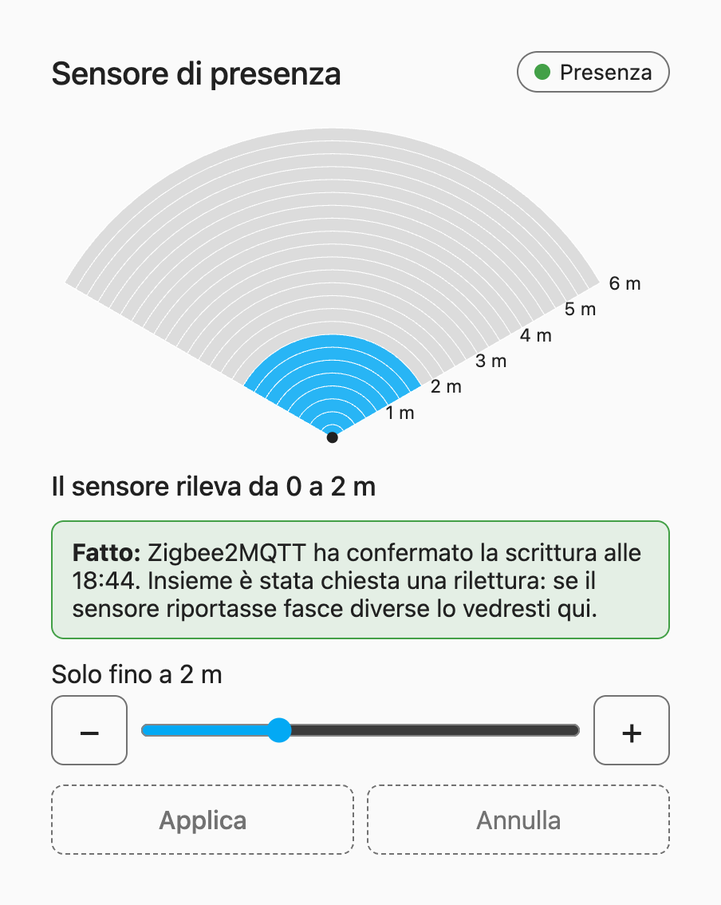
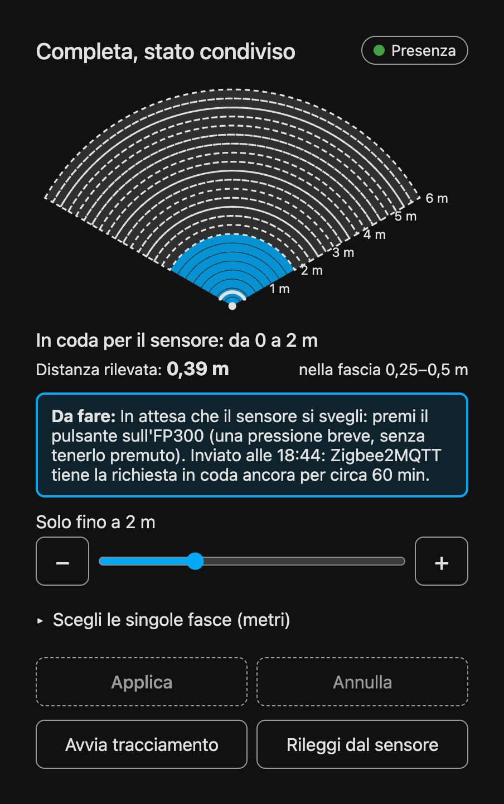
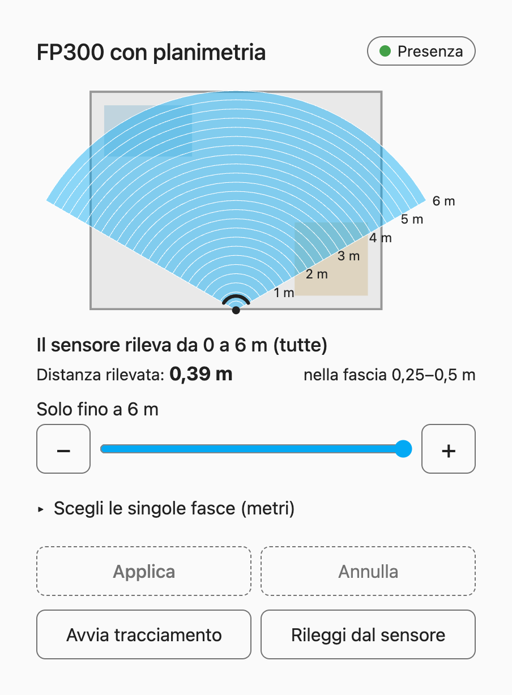

# 📡 FP300 Range Card

A Home Assistant dashboard card to choose **how far your Aqara FP300 looks**.

The FP300 is a presence sensor. Out of the box it watches everything up to 6 metres, so the light
in one room can turn on when someone walks past the door. This card lets you tell the sensor
"watch only up to 2 metres", or switch off single slices of distance, by tapping a picture.

It works with an FP300 on Zigbee firmware, connected through **Zigbee2MQTT** (model `PS-S04D`).

<p align="center">
  
  
</p>

## ✨ What it does

- 🪭 **A fan seen from above.** 24 rings of 25 cm each. Blue means the sensor watches there.
- 💬 **A plain sentence.** "Il sensore rileva da 0 a 2 m" tells you what is active at a glance.
- 📏 **A limit you can nudge.** A slider with − and + buttons, 25 cm per step.
- ✏️ **A draft.** Nothing is sent until you press **Applica**. **Annulla** throws the draft away.
- ⏳ **Honest waiting.** The sensor sleeps to save its batteries. The card tells you to press the
  button on the sensor, and how long the request stays valid.
- ⚠️ **A warning if the bands change.** If the sensor reports bands that differ from the ones you
  applied, the card says which ones.
- 🎯 **Distance tracking.** See how far the sensor thinks you are, and in which band you stand.
- 👪 **A simple mode** for the rest of the family, and a floor plan as background if you like.

The user interface is in Italian.

<p align="center">
  
  
</p>

## 🚀 Quick start

1. **Get the card.** In the Home Assistant Marketplace (HACS on older versions) add
   `thekoma/fp300-range-card` as a custom repository of type **Dashboard**, then download it.
2. **Add the sensors.** Copy [`packages/fp300_range.yaml`](packages/fp300_range.yaml) to
   `/config/packages/`, put the friendly name of your FP300 in it, and restart Home Assistant.
3. **Add the card** to a dashboard:

   ```yaml
   type: custom:fp300-range-card
   entity: sensor.fp300_raw_fp300_a
   applied_entity: sensor.fp300_applied_fp300_a
   friendly_name: fp300_a
   ```

Every step is explained in the [installation guide](docs/installation.md).

## 📚 Where to go next

| I want to… | Read |
|---|---|
| Install it step by step, and see every option | [docs/installation.md](docs/installation.md) |
| Understand what the card sends and why I must press the button | [docs/how-it-works.md](docs/how-it-works.md) |
| Check that a change really reaches the sensor | [docs/testing.md](docs/testing.md) |

## 🧪 Status

The logic is covered by automated tests and the card was tried against a demo page that fakes
Home Assistant and Zigbee2MQTT. Use the [test checklist](docs/testing.md) on your own sensor
before you rely on it.
